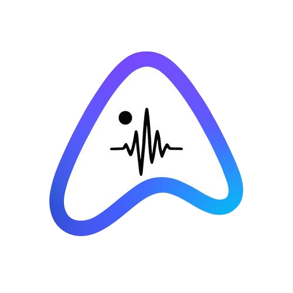

# RainerTek EchoAI — Enterprise AI Voice Platform

<div align="center">
  
  <h3>Internal AI Voice Assistant Platform for RainerTek</h3>
  <p>Engineered for HRMS, QMS, LIMS and Enterprise Telephony</p>
  <p><strong>Next.js 16 • TypeScript • Three.js 3D Visualizer • Tailwind CSS • Sarvam AI</strong></p>
</div>

---

## 🌟 Executive Overview

**RainerTek EchoAI** is an advanced internal AI voice-agent platform for RainerTek. It orchestrates inbound and outbound enterprise telephony, answers employee and regulatory questions using approved internal knowledge, connects to authorized company systems (HRMS, QMS, LIMS), manages structured AI agent prompts with version history rollback, maintains complete call records, and displays real-time operational telemetry.

---

## 🧭 Application Navigation Architecture (11 Sections)

EchoAI features a persistent enterprise sidebar providing access to all 11 core modules:

1. **Overview Dashboard (`/`)**: 10 summary KPI metrics (total calls, inbound/outbound distribution, duration, escalation rate, AI/SIP costs), SVG trends, failed call triage, and audit feed.
2. **Live Voice Workspace (`/live`)**: Central procedural 3D assistant orb powered by Three.js with 8 visual states (`idle`, `connecting`, `listening`, `thinking`, `speaking`, `muted`, `completed`, `failed`), live audio-reactive waveform, turn-by-turn transcript stream, cited knowledge sources, and call controls (mute, warm escalation handoff to human supervisor).
3. **AI Agents & Prompt Engineering (`/agents`)**: Directory of project-isolated voice agents with structured system instructions (Identity, Role, Scope, Tone, Operating Instructions, Strict Restrictions, Escalation Criteria), prompt version history with one-click restore, and a conversation test playground.
4. **Knowledge Base (`/knowledge`)**: Drag-and-drop first document management workspace supporting PDF, Markdown (.md), and TXT with file type validation, chunk status indicators, vector re-indexing, and a full Document Editor modal with markdown preview.
5. **Call History & Telephony Records (`/calls`)**: Searchable/filterable call history table with multi-parameter filtering and an interactive Call Detail Drawer featuring a simulated audio waveform player, turn transcripts, cited documents, and detailed cost breakdown (STT, LLM, TTS, SIP).
6. **Inbound Call Routing (`/inbound`)**: Carrier phone number mapping to designated AI agents and projects, greeting prompt customization, and fallback human destination rules.
7. **Outbound Calling Campaigns (`/campaigns`)**: Automated broadcast campaigns with contact verification, telecom DND checks, quiet-hour enforcement (21:00-08:00), script approval, and safe preview controls.
8. **Analytics & Usage Telemetry (`/analytics`)**: Internal usage reporting by project and agent, concurrency metrics, estimated vs provider-confirmed charges, and CSV export.
9. **Enterprise Integrations (`/integrations`)**: Safe connectors catalogue for Sarvam AI, HRMS, QMS, LIMS, and SIP trunks with health telemetry and actionable status messages (no raw secrets exposed).
10. **Team & Permissions (`/team`)**: Role-Based Access Control (Administrator, Operator, Read-only viewer), multi-project access scopes, hardware MFA verification, and an active capabilities matrix.
11. **Compliance & Audit Trail (`/audit`)**: Immutable 21 CFR Part 11 / GxP audit logs recording prompt edits, document updates, campaign launches, and JSON export for regulatory compliance.
12. **General Platform Settings (`/settings`)**: Audio telephony codec negotiation (Opus 24kHz, G.711u, PCM 16kHz), data retention policies, and automatic PII redaction.

---

## 🎨 Enterprise Design System

- **Color Palette**: Deep navy background (`#0A0F1D`), refined card surfaces (`#111A2E`), slate borders (`#1E293B`), cyan (`#38BDF8`) & indigo (`#6366F1`) restrained accents, and emerald (`#10B981`) operational indicators.
- **Logo Integration**: Reused official transparent RainerTek EchoAI logo.
- **Information Density**: High-density enterprise layout without generic decorative AI gradients or oversized elements.
- **Data Grounding**: Every metric is derived and labeled with `DEMO` tags where mock data is used, ensuring full integrity.

---

## 🛠️ Tech Stack & Dependencies

- **Frontend Framework**: Next.js 16 (App Router with Turbopack)
- **Language**: TypeScript 5
- **3D Graphics**: Three.js (`three` & `@types/three`)
- **Styling**: Tailwind CSS
- **Iconography**: Lucide React
- **Validation**: React Hook Form & Zod
- **Voice Synthesis & AI**: Sarvam AI API endpoints (`/api/sarvam/chat` & `/api/sarvam/tts`)

---

## ⚡ Running Locally

### 1. Clone and Install
```bash
git clone https://github.com/mrbanoth/rainertek-echoai.git
cd rainertek-echoai
npm install
```

### 2. Configure Environment (Optional for Live Voice Synthesis)
Create a `.env.local` file:
```env
# Optional: Sarvam AI API Subscription Key for voice synthesis
SARVAM_API_KEY=your_sarvam_api_key_here
```

### 3. Start Development Server
```bash
npm run dev
```
Open [http://localhost:1111](http://localhost:1111) in your browser.

### 4. Build for Production
```bash
npm run build
npm start
```

---

## 📋 Real vs Simulated Implementation Status

| Feature | Status | Implementation Details |
|---|---|---|
| **All 11 Product Screens & Navigation** | ✅ Real | Fully functional Next.js App Router with responsive navigation & state. |
| **Procedural 3D Visualizer** | ✅ Real | Three.js WebGL procedural orb with all 8 visual states & audio responsiveness. |
| **Prompt Architecture & Version Rollback** | ✅ Real | Interactive structured editor with diff notes, version history & restore. |
| **Drag & Drop Knowledge Ingestion** | ✅ Real | File drag & drop, file type/size validation, and Document Editor modal. |
| **Call Detail Drawer & Waveform** | ✅ Real | Slide panel with simulated audio waveform playback, turns & cost telemetry. |
| **Project & Role-Based Access Control** | ✅ Real | Isolated project boundaries (HRMS, QMS, LIMS) & Administrator/Operator/Viewer roles. |
| **Audit Trail & JSON Export** | ✅ Real | Immutable audit event log with JSON and CSV export capabilities. |
| **Sarvam Voice Synthesis API** | ✅ Ready | Integrates with Sarvam API when key is provided; falls back gracefully to client synthesis. |
| **Active Telephony Carrier Dialing** | 🟡 Simulated | Safely mocked to prevent accidental charges or carrier dialing without provider setup. |
